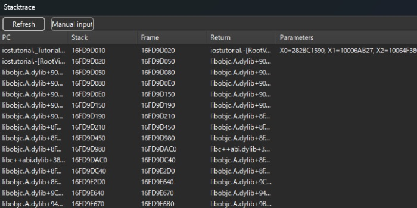
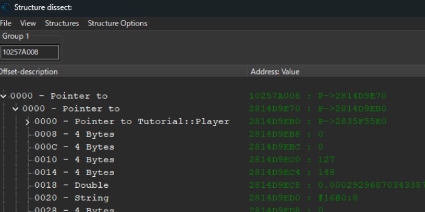
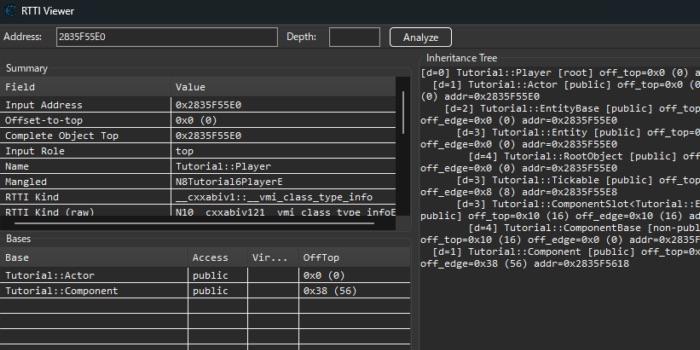

# ceserver-ios

An iOS port of Cheat Engine's ceserver for jailed and jailbroken devices.  
Windows plugins add support for iOS stack traces and RTTI.  
It may contain bugs or be unoptimized. Feedback is welcome.

## About this fork

Actively maintained as an RE arsenal tool: weaknesses found while using the
tool in real projects are logged in [FINDINGS.md](FINDINGS.md) (consumers only
add rows; fixes land here). Binary builds and versioned releases are produced
by CI (macOS runners + Theos) on every push and tag — do not distribute ad-hoc
binaries.

## Features
Memory search/read/write, breakpoint/watchpoint, pointer scan, instruction patching, register patching, symbols, etc.  
*Executable memory patching requires a jailbroken device.*


## Usage
#### Jailed
1. Inject the dylib into your target app IPA.
2. Sideload the IPA.
3. Launch the app (the server starts automatically).

#### Jailbreak
1. Copy `ceserver` to the device (e.g. `/var/jb/usr/bin`).
```bash
cd /var/jb/usr/bin
chmod 755 ceserver
./ceserver
```


### PC Connection
#### Wired connection (`recommended`)

```bash
iproxy 52736 52736
# In Cheat Engine, use Network and connect to:
127.0.0.1:52736
```

#### Wireless connection
```bash
# In Cheat Engine, use Network and connect to:
[device IP]:52736
```


## Plugins
Cheat Engine doesn't support iOS stack traces/RTTI natively, so these plugins are required for those features.  


Stacktrace (Main menu → Plugins → iOS-Stacktrace)  
When a breakpoint hits, click Refresh to update the list.


Structure Dissect (Memory viewer → Tools → Dissect data/structures, built-in)  


RTTI Viewer (Main menu → Plugins → iOS-RTTI-Viewer)  


## Components
- `ceserver-ios/jailbreak/`
  Standalone server binary for jailbreak devices.
- `ceserver-ios/jailed/`
  Dylib build for jailed/sideloaded apps.
- `plugin/ios_stacktrace/`
  Windows CE plugin for iOS stack traces.
- `plugin/ios_rtti/`
  Windows CE plugin for RTTI inspection (includes a small LLVM demangler subset).

## Credits
[Cheat Engine](https://github.com/cheat-engine/cheat-engine) : The original ceserver implementation.
## Licenses
[MIT License](./LICENSE)  
[LLVM](https://github.com/llvm/llvm-project) `LICENSES/LLVM.TXT`
